<div align="center">

# Glass Morphism

**Liquid Glass for the web.** Real refraction, moving specular highlights, and iOS 26-style glass components.<br>
Zero dependencies · ~30 KB · MIT

```sh
npm install @sasivisvan/glass-morphism
```

[**Website**](https://glass-morphism-flax.vercel.app) · [Demos](https://glass-morphism-flax.vercel.app/demo/) · [npm](https://www.npmjs.com/package/@sasivisvan/glass-morphism) · [Getting started](docs/getting-started.md) · [API](docs/api.md) · [Components](docs/components.md) · [How it works](docs/how-it-works.md)

[](https://www.npmjs.com/package/@sasivisvan/glass-morphism)   

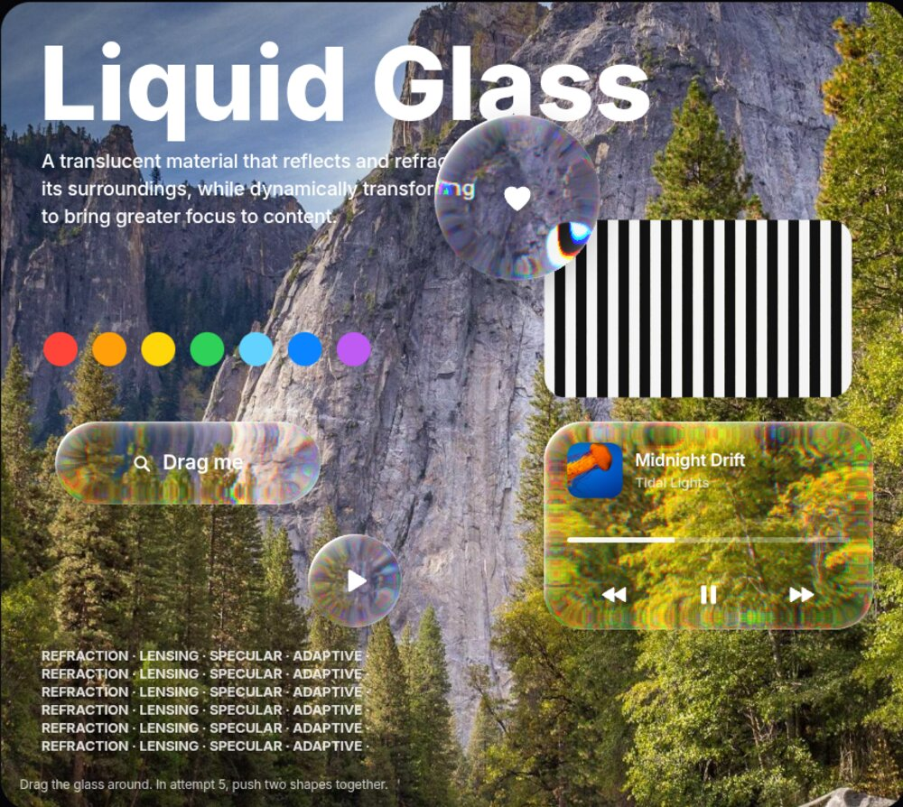

</div>

Most "glassmorphism" on the web is a blur. Apple's Liquid Glass **bends light**: the curved rim of each control refracts what's behind it while the centre stays clear. This library computes that refraction from physics (Snell's law over a curved glass rim), renders it with SVG displacement maps through `backdrop-filter`, and wraps it in ready-made components that behave like iOS 26's.

## Features

- **Physically based refraction.** Squircle rim profile, index of refraction, magnification and chromatic dispersion.
- **Specular rims** that follow the pointer or device tilt.
- **Presets** tuned side by side against iOS: `regular`, `clear`, `tinted`, `prism`, `lens`, `thumb`.
- **Components**: button, switch, slider, segmented control, tab bar, toolbar, morphing menu. Thumbs turn into magnifying lenses when pressed.
- **Glass text.** Any string, like the iOS 26 lock screen clock.
- **WebGL renderer** for every browser, with shapes that melt together.
- **Progressive.** Frosted CSS fallback in Firefox and Safari, and with no JavaScript at all. Real `<input>`s underneath, and support for reduced transparency and reduced motion.
- **Tiny and dependency-free.** UMD + ES modules + TypeScript types.

## Quick start

```html
<link rel="stylesheet" href="https://cdn.jsdelivr.net/gh/Sasivisvan/Glass-Morphism@v1.0.2/dist/liquid-glass.css">
<script src="https://cdn.jsdelivr.net/gh/Sasivisvan/Glass-Morphism@v1.0.2/dist/liquid-glass.js"></script>

<div style="background:url(photo.jpg) center/cover; padding:80px">
  <div class="lg" data-liquid-glass="clear" style="border-radius:32px; padding:24px">Hello, glass</div>
  <button class="lg-button">Glass button</button>
  <label class="lg-switch"><input type="checkbox" checked></label>
</div>

<script>LiquidGlass.init({ light: 'pointer' });</script>
```

Or with npm:

```sh
npm install @sasivisvan/glass-morphism
```

```js
import LiquidGlass from '@sasivisvan/glass-morphism';
import '@sasivisvan/glass-morphism/css';

LiquidGlass.init();
LiquidGlass.attach(document.querySelector('.card'), { preset: 'clear', chromatic: .08 });
```

## Components

<table>
<tr>
<td width="50%"><b>Presets</b> — <code>data-liquid-glass="regular | clear | tinted | prism"</code><br>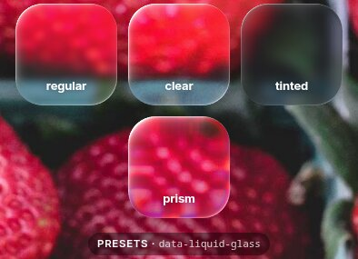</td>
<td width="50%"><b>Buttons</b> — <code>.lg-button</code>, <code>--prominent</code>, <code>--icon</code><br>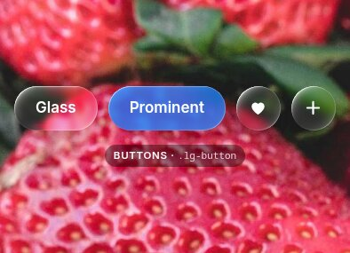</td>
</tr>
<tr>
<td colspan="2"><b>Switch &amp; slider</b>: at rest, then pressed. The thumb becomes a magnifying lens.<br>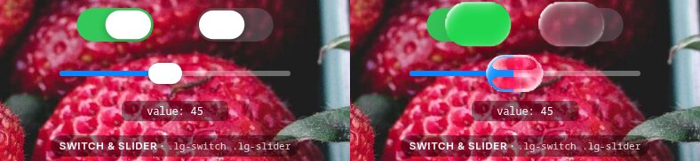</td>
</tr>
<tr>
<td colspan="2"><b>Segmented control</b>: drag the selection and it turns into a droplet that magnifies the labels.<br>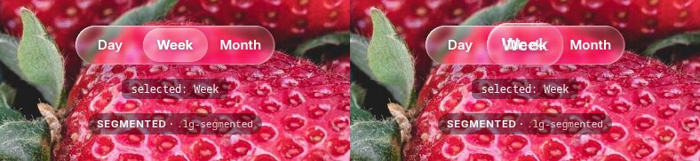</td>
</tr>
<tr>
<td colspan="2"><b>Tab bar</b>: the same droplet selection, with <code>aria-current</code> and <code>lg-change</code> events.<br>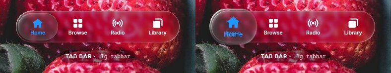</td>
</tr>
<tr>
<td colspan="2"><b>Morphing menu</b>: the button morphs into the menu, and the refraction follows the shape.<br>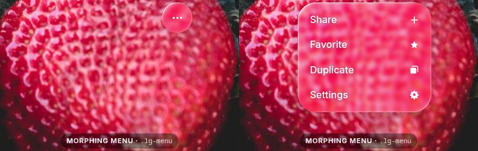</td>
</tr>
<tr>
<td width="50%"><b>Toolbar</b> — <code>.lg-toolbar</code><br>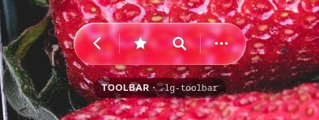</td>
<td width="50%"><b>Glass text</b> — <code>attachText(el, 'Glass')</code><br>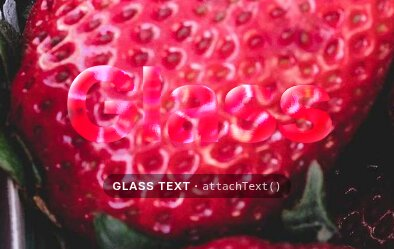</td>
</tr>
</table>

Full markup, events and theming: **[docs/components.md](docs/components.md)**.

## Recreations

The [demo site](https://glass-morphism-flax.vercel.app/demo/) rebuilds real iPhone screens, each with several attempts you can flip between (keys <kbd>1</kbd>–<kbd>5</kbd>) to compare techniques.

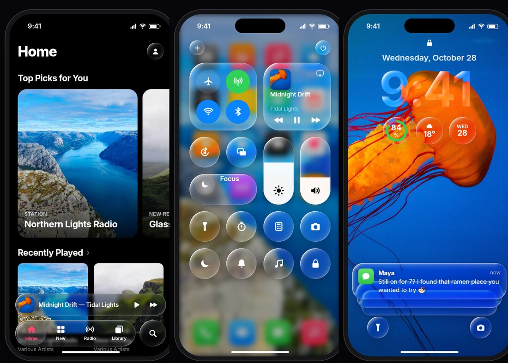

| Demo | What it shows |
| --- | --- |
| [Lens Lab](demo/lens.html) | The material itself, with live sliders. CSS blur → noise → Snell's law → dispersion → WebGL with merging shapes |
| [Floating Tab Bar](demo/tabbar.html) | iOS 26 app chrome: tab bar that minimises on scroll, droplet selection, scroll-edge blur |
| [Control Center](demo/control-center.html) | iOS 18 vs iOS 26 Clear vs iOS 26.1 Tinted |
| [Lock Screen](demo/lockscreen.html) | Glass clock built from the digits, clear notification stack |
| [Components](demo/components.html) | Every library component, using only `LiquidGlass.init()` |
| [Classic Materials](demo/materials.html) | The iOS 7–18 blur hierarchy, light and dark |

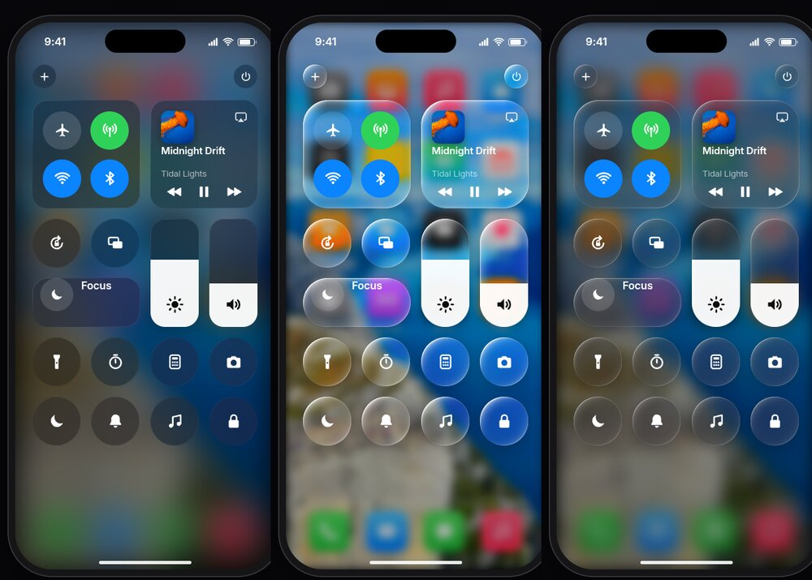

## API at a glance

```js
LiquidGlass.attach(el, 'regular' | { preset, bezel, thickness, ior, blur, chromatic, magnify, specular, … })
LiquidGlass.detach(el)
LiquidGlass.get(el)?.update({ magnify: .2 })
LiquidGlass.init(root?, { observe?, light?: 'pointer' })
LiquidGlass.setLight(angle) / LiquidGlass.followPointer()
LiquidGlass.attachText(el, '9:41', { font, preset })
new LiquidGlassGL(canvas, source, params)   // dist/liquid-glass-gl.js
```

See the **[API reference](docs/api.md)** for every option and default.

## Browser support

| | Refraction | Fallback |
| --- | --- | --- |
| Chrome, Edge, Brave, Arc, Opera | ✅ SVG `backdrop-filter` | — |
| Firefox, Safari | — | ✅ frosted blur + rim highlights |
| Any browser with WebGL2 | ✅ via `LiquidGlassGL` | — |

Only Chromium accepts SVG filters in `backdrop-filter` today. **[How it works](docs/how-it-works.md)** covers the optics, the Chromium quirks, and the limits.

## Built with glass-morphism

Using it? Add the badge to your site (it's glass too):

```html
<a class="lg lg--pill" data-liquid-glass="clear" href="https://github.com/Sasivisvan/Glass-Morphism"
   style="position:fixed;right:18px;bottom:18px;padding:11px 16px;color:#fff;font:600 13px system-ui;text-decoration:none">
  Built with glass-morphism
</a>
```

Or in a README: [](https://github.com/Sasivisvan/Glass-Morphism)

```md
[](https://github.com/Sasivisvan/Glass-Morphism)
```

## Development

```sh
npm run build   # src/ → dist/
npm run dev     # build + serve on http://localhost:8931
```

No dependencies to install. See [CONTRIBUTING.md](CONTRIBUTING.md).

## Credits

- **[Sasivisvan](https://github.com/Sasivisvan)**: creator and maintainer
- **[Kathin-M](https://github.com/Kathin-M)**: contributor
- The Snell's-law displacement approach builds on [kube.io's "Liquid Glass in the browser"](https://kube.io/blog/liquid-glass-css-svg/).
- Demo photos are from [Unsplash](https://unsplash.com) via [Lorem Picsum](https://picsum.photos) and are covered by the [Unsplash License](https://unsplash.com/license), not by this project's MIT license.

## License

[MIT](LICENSE) © 2026 Sasivisvan and contributors.

*An independent open-source project. Not affiliated with or endorsed by Apple Inc. "Liquid Glass", iOS and iPhone are trademarks of Apple Inc.*
