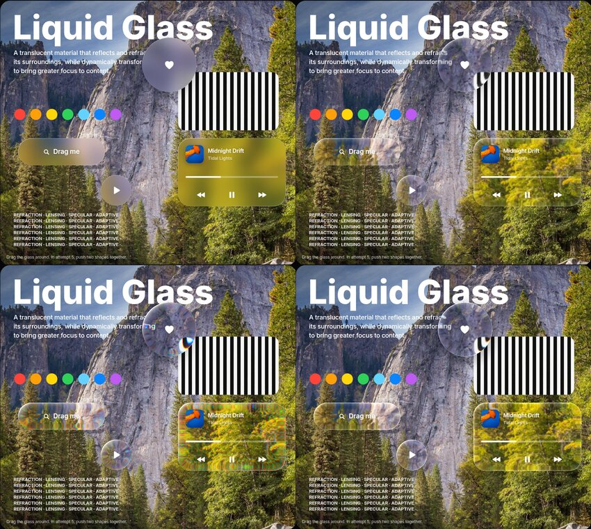

# How it works

## What we're imitating

Apple's Liquid Glass (WWDC, June 2025; iOS 26) is described as a material that *reflects and refracts its surroundings*. Compared with the frosted materials of iOS 7–18, the difference is **lensing**: the rim of each control is curved, so light passing through it bends. Content near the edge gets compressed and pulled inward, while the flat centre stays clear. On top of that, a thin **specular highlight** runs along the lit edge and moves as the device tilts.


*Top: CSS blur, Snell's-law refraction. Bottom: plus dispersion and magnification, WebGL.*

## The pipeline

### 1. Shape

For an element of `W × H` with corner radius `r`, we evaluate the signed distance to a rounded rectangle at every pixel. Inside a band of width `bezel` from the edge, the glass surface curves; beyond it, the glass is flat.

### 2. Surface profile

The rim height follows a profile `f(t)`, where `t` is depth into the bezel (0 at the edge, 1 where the glass goes flat). The default is a squircle, `f(t) = ⁴√(1 − (1 − t)⁴)`, which rises steeply and then flattens smoothly, close to Apple's look. A raised `'lip'` profile is also available.

### 3. Snell's law

At each rim pixel, the surface slope is `f′(t) · thickness / bezel`. That gives the angle of incidence `θ₁`. Snell's law with air (n = 1) and glass (n = `ior`) gives the refracted angle `θ₂ = asin(sin θ₁ / n)`. The ray deviates by `θ₁ − θ₂` and travels through the local glass height, so its sideways shift is:

```
shift = tan(θ₁ − θ₂) · thickness · f(t)
```

The shift points inward, along the negative distance-field gradient. Pointing inward means we never sample outside the element, where `backdrop-filter` has no pixels.

### 4. Displacement map

Shifts are normalised by their maximum and packed into an image: `R = 128 + 127·x`, `G = 128 + 127·y`. That image goes into SVG `<feDisplacementMap>` with `scale = 2 · max`. Optional magnification adds a pull toward the centre. Optional dispersion runs three displacements at slightly different scales and keeps one colour channel from each.

### 5. Specular map

A second image holds the rim light. Its intensity depends on how much the edge normal faces `lightAngle`, with a weaker reflection on the opposite side. It's sharpest at the outer edge and is composited over the refracted backdrop.

### 6. Applying it

```css
backdrop-filter: blur(0px) url(#generated-filter);
```

Inside the filter the order is: refract → frost (`feGaussianBlur`) → saturate → specular. Frosting *after* refraction matters: blurring the backdrop first would leave nothing for the lens to bend, and the glass would read as plain frosted plastic.

Two Chromium details matter here:

- **Only Chromium** accepts SVG filters in `backdrop-filter`. Other browsers get a CSS blur fallback.
- **A CSS function must come before `url()`.** With `url()` alone, Chromium hands the filter a backdrop whose dark pixels arrive transparent, so black text and lines vanish. Even `blur(0px)` fixes it.

A `ResizeObserver` rebuilds the maps when the element changes size. Each rebuild gets a fresh filter id so Chromium re-resolves the reference. Maps are cached by size and options.

## Text and arbitrary shapes

For shapes without a distance field (text, logos), we rasterise the alpha, blur it with three box-blur passes into a smooth height field, and take its gradient as the normal. The same Snell's-law step turns that into a displacement map, and `mask-image` clips the element to the glyphs.

## The WebGL renderer

The same optics run in a fragment shader. Because the whole scene is one draw call, it can also:

- blend the distance fields of several shapes with a smooth minimum, so they **merge like droplets** when close (SwiftUI's `GlassEffectContainer` morphing);
- frost by sampling texture mipmaps;
- fringe colour per channel, brighten the rim (Fresnel), and cast a soft shadow.

The cost: it can only refract a texture, so the backdrop has to be painted into a canvas.

## Interaction model

The components copy iOS 26's behaviour:

- **Pressed thumbs become lenses.** The switch and slider thumbs are solid white at rest. On press the white fades, the thumb scales up ~1.5× with a spring, and the `lens` preset (with magnification) is applied, so the track shows through enlarged.
- **Selections are droplets.** The segmented control and tab bar indicator sit *after* the items in the DOM, so their backdrop contains the labels, which the lens then magnifies while you drag.
- **Buttons respond to touch.** They grow and a radial glow follows the finger.
- **Light moves.** `followPointer()` re-lights every specular map from the pointer or device orientation.

## References

- [Apple Newsroom: Apple introduces a delightful and elegant new software design](https://www.apple.com/newsroom/2025/06/apple-introduces-a-delightful-and-elegant-new-software-design/)
- [Apple Developer: Applying Liquid Glass to custom views](https://developer.apple.com/documentation/SwiftUI/Applying-Liquid-Glass-to-custom-views)
- [kube.io: Liquid Glass in the browser](https://kube.io/blog/liquid-glass-css-svg/), the Snell's-law displacement approach this builds on
- [LogRocket: How to create Liquid Glass effects with CSS and SVG](https://blog.logrocket.com/how-create-liquid-glass-effects-css-and-svg/)
